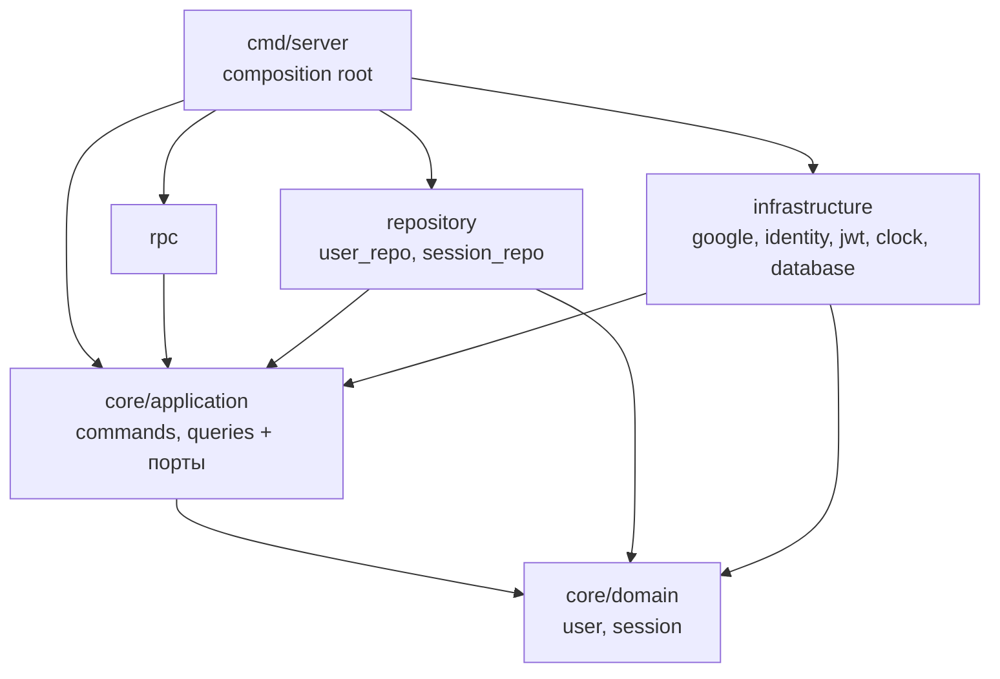

# users-be

Backend-сервис пользователей на Go. Сервис предоставляет gRPC `UsersService`; HTTP API для клиента реализует [gateway-be](../gateway-be), который проверяет access-cookie, передаёт запросы в users-be и устанавливает cookies.

Контракт gRPC и HTTP-маршруты находятся в [proto/users](../gateway-be/proto/users). users-be импортирует сгенерированные типы из модуля gateway-be; используемая версия закреплена в `go.mod`.

## Возможности

- Вход через настроенных внешних провайдеров: Google, GitHub и Yandex.
- Создание пользователя при первом входе и привязка нескольких провайдеров к одному пользователю.
- Access JWT и ротация refresh-токенов; refresh-токены хранятся в БД только в виде хеша.
- Выход с отзывом текущей refresh-сессии.
- Получение и изменение профиля: nickname, location и show_online_status.
- Просмотр, привязка и отвязка внешних identities.
- GeoIP-определение примерной локации нового пользователя по клиентскому IP через `ipapi.co`.

## Структура

```text
cmd/server/                         запуск и composition root
internal/core/domain/               доменные модели user и session
internal/core/application/commands/ сценарии входа, сессий, identities и профиля
internal/core/application/queries/  получение профиля и identities
internal/infrastructure/            Postgres, GeoIP, OAuth-провайдеры, JWT и часы
internal/repository/                PostgreSQL-реализации портов
internal/rpc/                       gRPC-адаптеры и metadata
migrations/                         SQL-схема и задания pg_cron
```

Ядро зависит от интерфейсов, а gRPC, PostgreSQL, GeoIP и OAuth-провайдеры подключаются во внешних слоях.

### Зависимости слоёв

Стрелка — «импортирует». Ядро ни от кого не зависит, все зависят от него.



- `rpc` знает только сценарии (`application`), домен не трогает.
- Порты объявлены там, где ими пользуются: общие для нескольких команд — `commands/ports.go`, остальные — в файле своего обработчика.
- Адаптеры реализуют порты и проверяют это при компиляции: `var _ commands.SessionRotator = (*Repository)(nil)`.

## HTTP API

Все HTTP-маршруты обслуживает gateway-be. За исключением входа, обновления токена и выхода, запросы требуют cookie `access_token`.

| Метод | Путь | Назначение |
|---|---|---|
| `POST` | `/api/v1/auth/login/{provider}` | Вход через `google`, `github` или `yandex` |
| `POST` | `/api/v1/auth/refresh` | Обновление access- и refresh-cookie |
| `POST` | `/api/v1/auth/logout` | Отзыв текущей refresh-сессии и очистка cookies |
| `GET` | `/api/v1/users/me` | Получить текущий профиль |
| `PATCH` | `/api/v1/users/me` | Обновить переданные поля профиля |
| `GET` | `/api/v1/identities` | Список привязанных провайдеров |
| `POST` | `/api/v1/identities/{provider}` | Привязать провайдера |
| `DELETE` | `/api/v1/identities/{provider}` | Отвязать провайдера, если остаётся способ входа |

`PATCH /api/v1/users/me` принимает необязательные `nickname`, `location` и `show_online_status`. Отсутствующие поля не меняются. Пустой nickname отклоняется.

При входе Google передаёт `id_token` в `Authorization`. Для GitHub и Yandex используются `x-auth-code` и, при PKCE, `x-code-verifier`. Успешный вход возвращает токены через gRPC response metadata; gateway выставляет их как HttpOnly cookies.

## GeoIP

При создании пользователя users-be берёт IP из gRPC metadata `x-forwarded-for` и вызывает `https://ipapi.co/{ip}/json/`. В БД сохраняется страна и город, если они доступны. Для существующего пользователя локация при повторном входе не пересчитывается.

Пустой или некорректный IP, а также loopback/private/link-local IP не дают результата. Поэтому при локальном запросе через `localhost` локация обычно остаётся пустой. В gateway заголовок `X-Forwarded-For` формируется из `c.IP()` и прокидывается как gRPC metadata. Если gateway стоит за reverse proxy, настройте доверие к прокси так, чтобы gateway получал IP клиента; не доверяйте произвольному клиентскому заголовку.

GeoIP — приблизительная геолокация по IP, а не GPS. Ошибка GeoIP не должна блокировать вход; она записывается в лог, а пользователь создаётся с пустой локацией.

## База данных

Таблицы создаются SQL-файлами в `migrations/` при первом запуске контейнера Postgres:

- `users` — профиль пользователя, включая `nickname`, `location` и `show_online_status`.
- `user_identities` — внешние identities; удаление пользователя каскадно удаляет identities.
- `refresh_tokens` — хеш refresh-токена, срок действия и метаданные сессии.
- `pg_cron` — ежедневная очистка истёкших refresh-токенов и старых деталей запусков cron.

Изменение файлов в `migrations/` автоматически не применится к уже созданному Docker volume. Для чистой локальной базы с повторным применением миграций используйте `docker compose down -v`; это удалит данные локальной БД.

## Локальный запуск

Нужны Go версии из `go.mod` и Docker Desktop.

1. Создайте локальный `.env` на основе `.env.example` и укажите `DB_PASSWORD`, `JWT_SECRET` длиной не менее 32 символов и credentials хотя бы одного провайдера.
2. Запустите Postgres:

   ```powershell
   docker compose up -d db
   ```

3. Запустите users-be локально:

   ```powershell
   go run ./cmd/server
   ```

Локальный сервер слушает `GRPC_PORT` (по умолчанию `50051`). Для подключения к Postgres по умолчанию используются `localhost:5433`, база `users`, пользователь `postgres`.

Чтобы запустить и Postgres, и приложение в контейнерах:

```powershell
docker compose up -d --build
```

В Docker Compose приложение подключается к Postgres по имени сервиса `db`. Переменные окружения берутся из shell и `.env`.

## Конфигурация

| Переменная | Значение по умолчанию | Назначение |
|---|---:|---|
| `GRPC_PORT` | `50051` | Порт gRPC-сервера |
| `DB_HOST` | `localhost` | Хост Postgres; в Docker Compose задаётся как `db` |
| `DB_PORT` | `5433` | Порт Postgres; в Docker Compose — `5432` |
| `DB_USER` | `postgres` | Пользователь Postgres |
| `DB_PASSWORD` | пусто | Пароль Postgres |
| `DB_NAME` | `users` | Имя базы |
| `DB_SSLMODE` | `disable` | Режим TLS для подключения к Postgres |
| `JWT_SECRET` | обязательно | Общий секрет users-be и gateway-be, минимум 32 символа |
| `ACCESS_TOKEN_TTL` | `15m` | Срок жизни access JWT |
| `REFRESH_TOKEN_TTL` | `720h` | Срок refresh-сессии; должен совпадать с настройкой refresh-cookie в gateway-be |
| `GOOGLE_CLIENT_ID` | пусто | Включает вход Google, когда задан |
| `GITHUB_CLIENT_ID` | пусто | Client ID GitHub; используется вместе с secret |
| `GITHUB_CLIENT_SECRET` | пусто | Client secret GitHub |
| `YANDEX_CLIENT_ID` | пусто | Client ID Yandex; используется вместе с secret |
| `YANDEX_CLIENT_SECRET` | пусто | Client secret Yandex |

Должен быть настроен хотя бы один провайдер: Google либо полная пара GitHub/Yandex.

## Проверки

Из корня users-be:

```powershell
go test ./...
```

Контракт берётся из версии `github.com/Game-WW/gateway-be`, закреплённой в `go.mod`. После изменения proto в gateway обновите зависимость users-be на нужный commit/tag, затем выполните:

```powershell
go get github.com/Game-WW/gateway-be@<commit-or-tag>
go mod tidy
go test ./...
```
